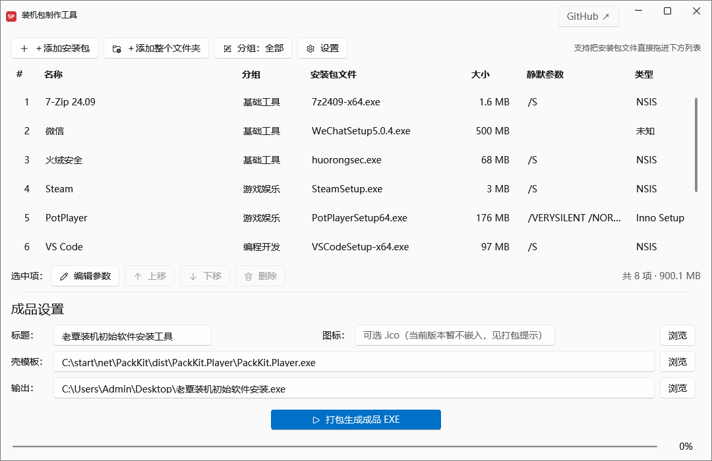
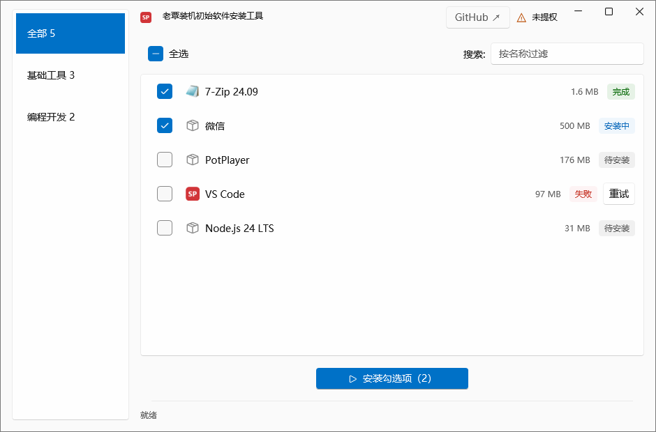
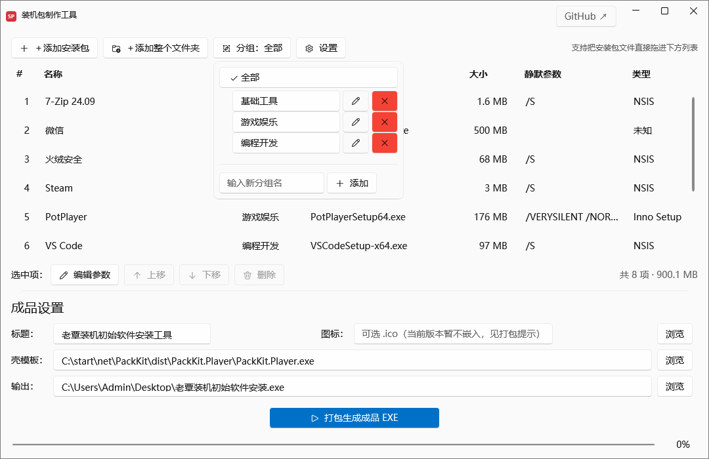

# PackKit — Windows 离线装机包工具

> 把常用软件的安装包打成一个绿色单文件 exe：重装系统后双击、勾选、自动静默安装。
> 无需联网、无需安装任何运行环境，整个工具连同软件包一起装进 U 盘随身带走。



## 这是什么

重装 Windows 后装软件是一件重复劳动：下载、找安装包、一个个点下一步。
PackKit 把这件事变成两步：

1. **平时**：用「制作端」把常用软件的安装包拖进去（自动识别安装器类型、预填静默参数、自动抽取图标），点一下打包，生成一个自解压的成品 exe；
2. **装机时**：把成品 exe 拷进 U 盘，在重装好的系统上双击 → 勾选要装的软件 → 自动按顺序静默安装。

成品 exe 内嵌了 .NET 8 运行时，**裸 Win10 / Win11 双击即用，目标机器零依赖**。

## 功能特性

### 制作端（PackKit.Builder）

- **三种添加方式**：多选文件、整个文件夹、直接拖拽，入列即自动识别安装器类型并抽取图标；
- **静默参数自动预填**：NSIS / Inno Setup / MSI / InstallShield / Squirrel 自动匹配默认静默参数，可逐项修改，参数留空则安装时人工点下一步；
- **分组管理**：新建 / 重命名 / 删除（删除时软件自动回落「未分组」），选中分组后新添加的安装包自动归组，下拉即是筛选器；
- **一键打包**：安装包集合 + 清单追加到壳尾部，产出独立单文件成品 exe，带进度显示与体积护栏；
- **工程自动保存**：所有配置随数据目录自动持久化，换包后重新打包即是「更新」；
- **数据安全**：数据目录可迁移，每日自动打包快照并同步到网盘目录（保留最近 14 份）。

### 成品端（PackKit.Player）

- 双击一次 UAC 提权，所有安装器继承管理员权限；
- 左侧分组筛选 + 搜索 + 多选/全选，按清单顺序**串行自动安装**；
- 每项状态实时可见（待安装 / 安装中 / 完成 / 失败），失败项可单独重试；
- 按需解压：只解压被勾选的安装包，几个 GB 的成品也不占额外空间。

## 界面预览

| 制作端 · 打包控制台 | 成品端 · 装机呈现 |
| --- | --- |
|  |  |

分组管理与筛选下拉（制作端）：



> 以上截图为演示数据。

## 静默安装支持

| 安装器类型 | 识别方式 | 默认静默参数 |
| --- | --- | --- |
| NSIS | 文件头特征（NullsoftInst） | `/S` |
| Inno Setup | 文件头特征 | `/VERYSILENT /NORESTART` |
| MSI | OLE 复合文档魔数 | `msiexec /qn /norestart` |
| InstallShield | 文件头特征 | `/s /v"/qn"` |
| Squirrel（Electron 系） | 文件头特征 | `--silent` |
| 未知 | 不猜测 | 留空 = 安装时人工点下一步（可手填参数） |

## 使用方法

**制作装机包**

1. 打开 `PackKit.Builder.exe`，把安装包拖进列表；
2. 按需调整名称、静默参数、分组与顺序；
3. 填写成品标题，点击「▶ 打包生成成品 EXE」，得到一个独立 exe。

**装机**

1. 把成品 exe 拷到重装好的电脑（U 盘 / 移动硬盘均可）；
2. 双击运行，UAC 提权后勾选要安装的软件；
3. 点击「▶ 安装勾选项」，等待全部完成即可。

## 已知限制

- **单个成品 exe 上限 4 GiB**：Windows 加载器无法执行达到 2^32 字节的可执行文件（实测超限即报「无法在你的电脑上运行」）。软件太多时请拆分成多个装机包，制作端会在打包时自动拦截超限请求；
- 部分国产「下一步流」安装器不支持静默参数，只能人工点下一步（已知悉参数时可在编辑对话框手填）；
- 成品 exe 暂不支持自定义图标嵌入（单文件壳形态的技术限制，打包时会明确提示）；
- 成品经 360 等杀软时可能因「自解压」特征误报，加入信任列表即可。

## 从源码构建

环境要求：Windows 10+，[.NET 8 SDK](https://dotnet.microsoft.com/download/dotnet/8.0)（WPF 桌面开发负载）。

```bash
# 构建（Debug）
dotnet build PackKit.sln

# 发布 self-contained 单文件 exe 到 dist/
powershell -ExecutionPolicy Bypass -File scripts/publish.ps1
```

发布产物：`dist/PackKit.Builder/PackKit.Builder.exe`（制作端）与 `dist/PackKit.Player/PackKit.Player.exe`（成品壳模板）。
打包成品时制作端会按约定路径自动定位壳模板，也可在界面手动指定。

## 目录结构

```
PackKit/
├─ PackKit.sln
├─ src/
│  ├─ PackKit.Core/        # 共享契约库：清单格式、payload 结构（壳+zip+footer）、安装器识别
│  ├─ PackKit.Builder/     # 制作端（WPF）：添加安装包、分组、打包
│  └─ PackKit.Player/      # 成品端壳（WPF）：自解压、多选、串行安装
├─ tools/
│  └─ PackKit.Harness/     # 实证探针：夹具/追加/读回/启动取证
├─ scripts/
│  ├─ publish.ps1          # 一键发布 self-contained 单文件 exe
│  └─ gen-brand-icon.ps1   # 品牌图标生成
├─ assets/                 # 图标等静态资源
├─ demo/                   # SFX 单文件机制最小演示（可双击验证）
└─ docs/images/            # README 截图
```

## 反馈

问题与建议请提交 [Issues](https://github.com/bug10111/PackKit/issues)。
